# Sprint 3 - Developing a Minimum Viable Product (MVP)

## Sprint Goals

Continue to develop the web application to the point that it provides all key functionality of the system. Test and refine it so that it can serve as the basis for the final phase of development.

### Specific Goals

- Create the following web pages:
    - Form for Sign in/up
    - Form for submitting unavailability
    - Form for submitting a request
    - Form for adding file
    - Form for resolving a request
    - Form for creating week
    - Page for displaying roster
    - Page for displaying individual week
    - Page for initializing weeks
    - Home page
- Develop SQL database queries to:
    - Add a new user
    - Add new weeks
    - Delete old weeks
    - select week data

## Testing Resolve request

I am testing to see whether the admin users can resolve requests made by a user. This can happen when a user unexpectedly falls ill, or makes plans after they submit their unavailability ect.. I tested this by making a request in an account, then logging into the admin account, and resolving the request. The request was able to be submitted and 
resolved, however, I noticed that people where being showed as possible replacements even when they didn't play that instrument.   

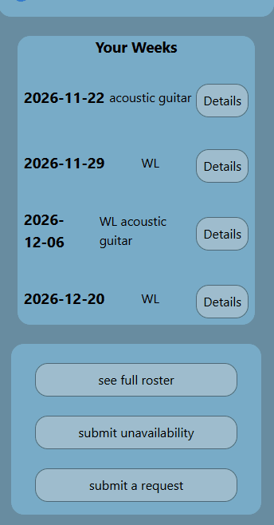

### Changes / Improvements

To improve the system, I added some code to add an "Instrument" to each person, and made it so that only people who played that instrument could be put down for that instrument

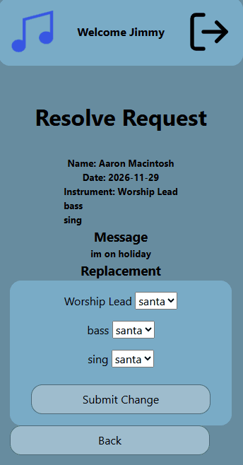

## Testing Week Initialization

I am testing to see if an admin user can initialize a week. This should make an empty week that, when the users submit their unavailability, the admin can populate with musicians, to get added to the roster. I tested this by making a few test weeks to see if the correct date week was made, and if it would be made correctly. The testing showed a positive result on creating weeks, and the correct date (one week since the previous week) was implemented.

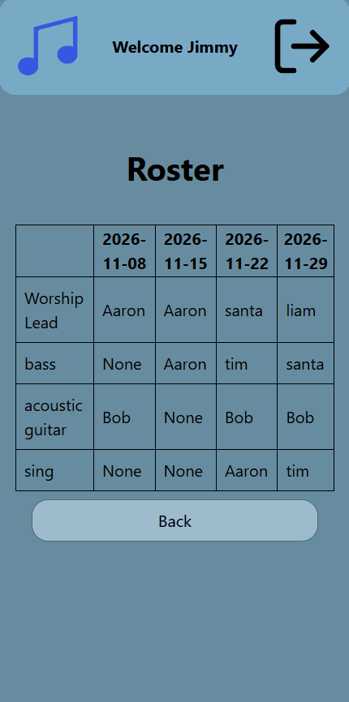

### Changes / Improvements

When I tested this, the system worked good, but when I was considering the UX, I realized that the current system returned the user to that weeks' creation page, but this would be a bad UX for the user, as no musicians would have been able to enter any unavailability yet, so no-one could be put in the system, so it was a useless feature. Furthermore, if the admin wanted to add multiple weeks at a time, they would have to exit a page every single time, which would get very annoying if you were trying to do a few months at time. To fix this, and thereby improving the UX by adhering to the UX principles of Clear User Flows and Keep Tasks Quick, I made the 'New' button redirect to the roster creation page. This made the task of creating weeks quick and clear, improving UX of the web app.

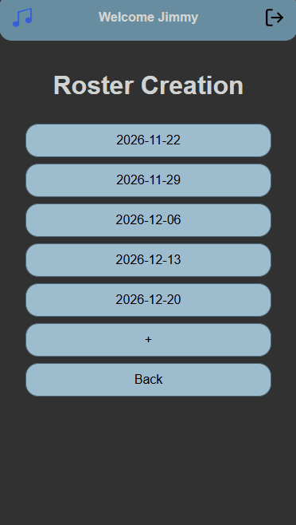

## Testing Week Creation

I am testing to see whether or not the admin can add people to a week, and for it to be updated throughout the site. I tested this by making a few empty test weeks, then submitting unavailability for different people, then making the new week, based off the availability. When I tested this, it would show a list of all the users that played that instrument, even if they said that they were unavailable. This means that people could be put down for weeks they said they couldn't do.

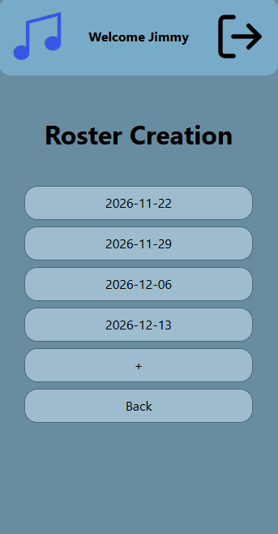

### Changes / Improvements

To fix this, I fixed a bug in the submitting unavailability form, where it would mark every week in the form as available, even if they said that they are unavailable for that day. When this got fixed, the form worked perfectly, as shown in the gif.

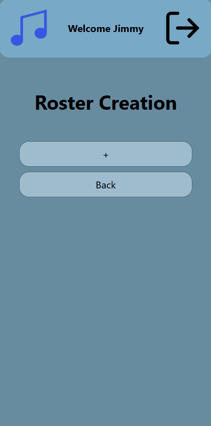

List of what the different test users put down for reference:

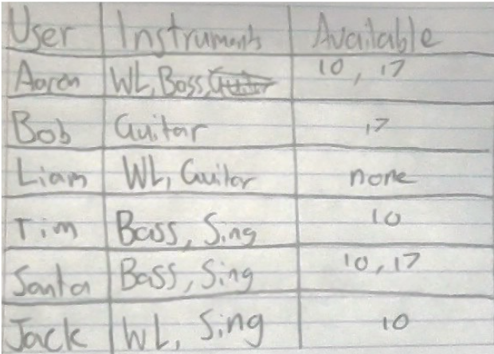

## Testing Submitting Unavailability

I am testing if the user can submit unavailability, and the if system handles it in the right way. To test this, I made a few test weeks, then went into a users account, and submitted unavailability. Then, I went to the admins account, and showed that the user did not show up as available to be on for the day that they submitted as unavailable. When I did this, the system worked as I expected it to, and the user only showed up on the days that they were available.

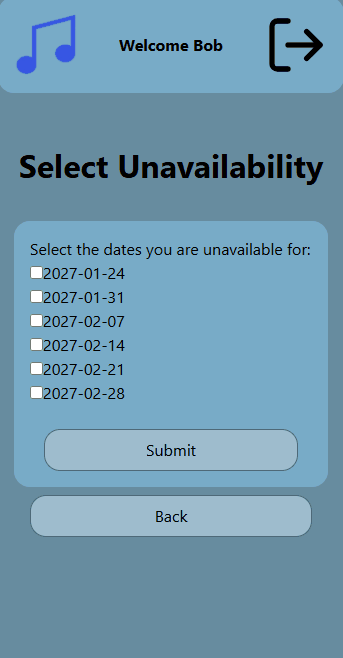

### Changes / Improvements

As my system worked well, it did not need any improvements.

## Testing Submitting a Request

I am testing to see if a user can successfully submit a request for one of their weeks. I tested this by submitting a trial request by a user. When I did this, the request was successfully handled by the program, and the correct things showed up for information when the admin went to resolve the request.

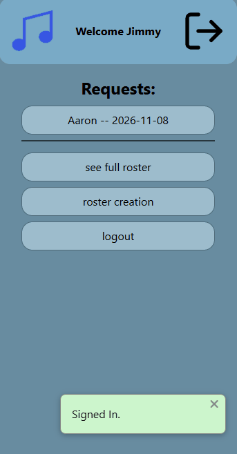

### Changes / Improvements

As the system worked as intended, the Web App did not need any improvements

## Testing Display of One Weeks Data

I am testing whether the system can display the data of a week when a user who is rostered for that week goes to see the information for that week. I tested this by making a test week with one of my test users being rostered for that week, and then seeing how the system displays the data. When I did this, the system displayed all the right data associated with the one week.

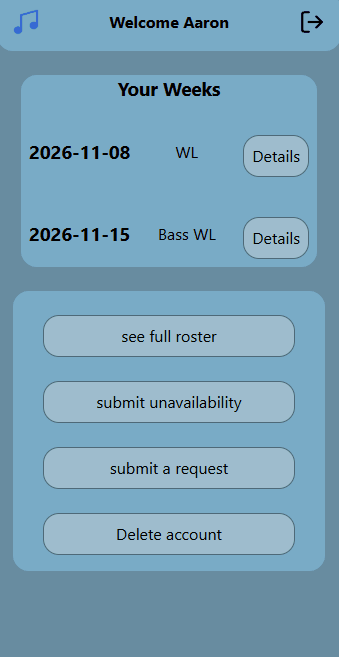

Data in db:

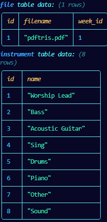

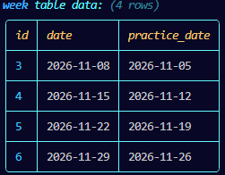

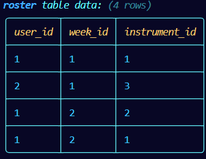

### Changes / Improvements

As the system worked fine, it did not need any improvements.

## Testing File Upload

I am testing to see if the system can upload a file to the system, to be displayed for users on that week to download. I tested this by uploading a file to a week where the user was a Week leader, as only week leaders can add files. When I added the file, it only allowed the correct file types to be selected, and when I uploaded it it got added successfully to the uploads folder, and users could successfully download the file.

Allowed Formats:

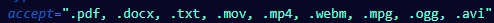

File Upload:

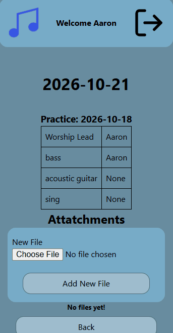

File Download:

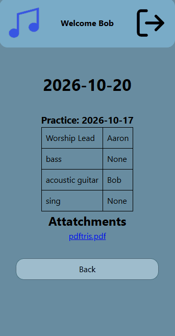

### Changes / Improvements

The system worked well, being able to handle uploading, downloading and only allowing certain types of files, so it did not need changing

## Testing Week Delete

I am testing the automatic delete of weeks. When the home page is opened, the program automatically checks for past weeks, and deletes them if any are present. I tested this by making a week in the past, with links to files, and all tables.

Weeks being deleted:

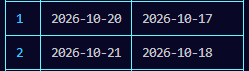

Data to be deleted:

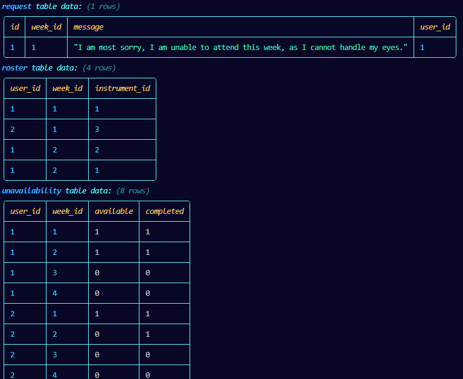

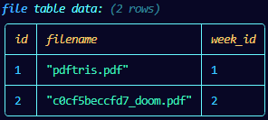

Delete actions:

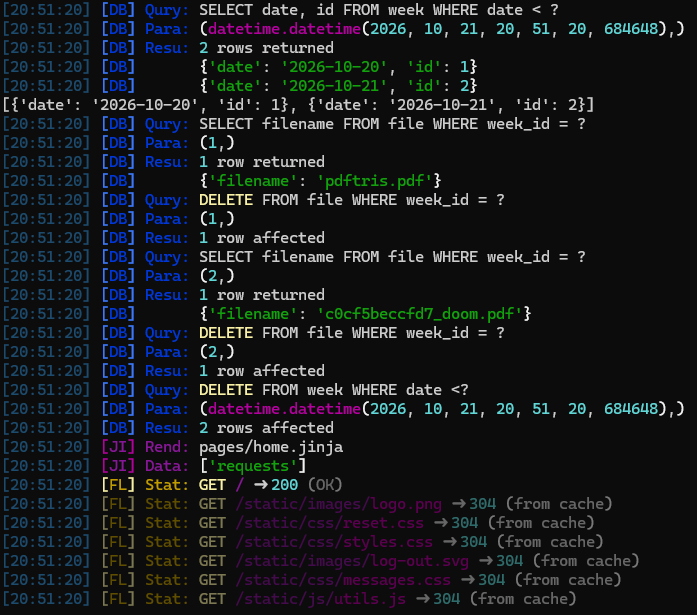

New Data:

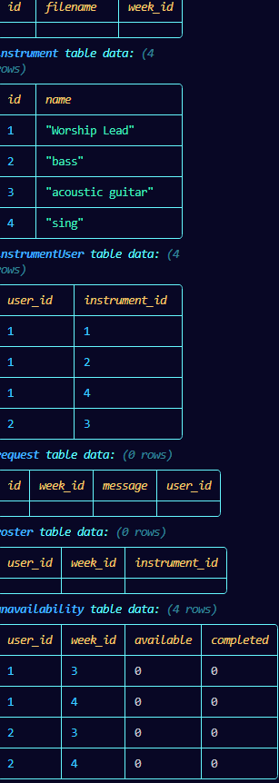

### Changes / Improvements

This worked well the first time, however, if a week is put in the db with seed data, if the file is already deleted, It would throw an error. To improve this, I added a check to make sure the app would only delete a file if one with its name exists in the uploads folder.

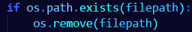

## Sprint Review

This sprint helped move the project forward, as it allowed me to make the web app work, and function as desired by the end user. It also allowed me to get a tangible and usable web app that I could test and make sure that it worked in the ways it was supposed to, and showed me bugs that needed fixing, ready for the final app. A key success point was the way that the project managed to come together and have a fully functioning app for the user and I to test. Something that didn't go well was the speed at which the project progressed. I would have liked to have more time to style and work on my project from an aesthetic point of view, but the functionality took longer than I was expecting.