# Sprint 3 - Developing a Minimum Viable Product (MVP)

## Sprint Goals

Continue to develop the web application to the point that it provides all key functionality of the system. Test and refine it so that it can serve as the basis for the final phase of development.

### Specific Goals

**Edit these goals as needed**

- Create the following web pages:
    - Form for ...
    - Etc.
- Develop SQL database queries to:
    - Add a new ...
    - Etc.

## Testing Roster display

I am testing the display of the roster. This is to see, with the test data I have put into the system, if it can display the full roster with every person and instrument in the correct week.

Using the following data, The roster returned should be:

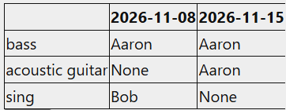

Table Contents:

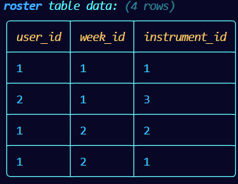
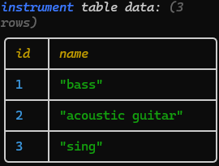

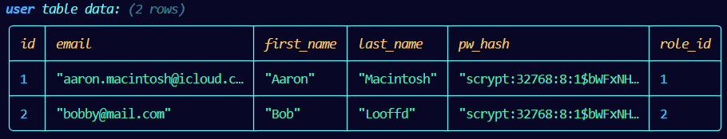
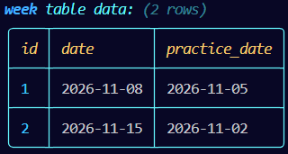

When I ran my algorithm (below), I kept getting an error, and when I fixed the error, it would return two empty lists, which is not what should happen.

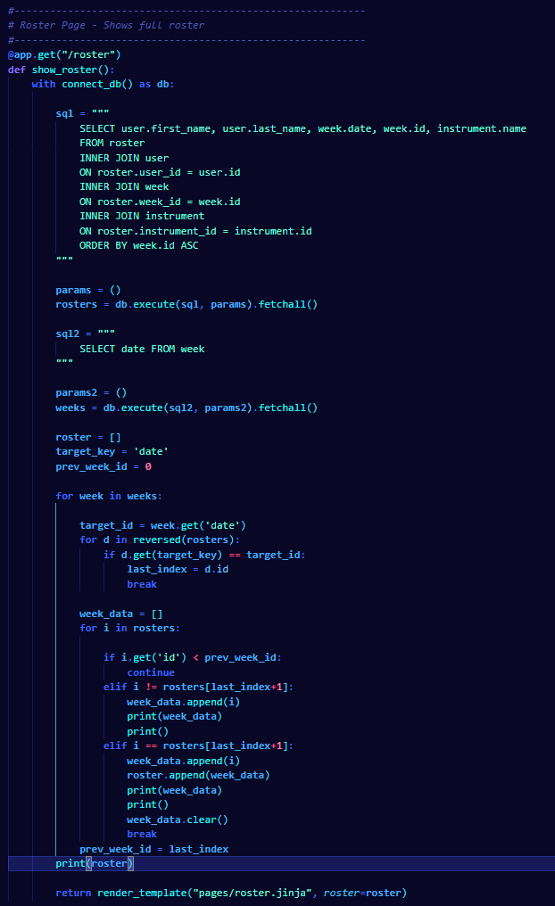

### Changes / Improvements

When this would not work, I came up with a new approach that was much simpler, and worked perfectly. This new SQL query makes use of a Cross Join to join the tables, which was something new that I hadn't learnt before, and would then loop through the data on the Jinja template to get the correct display.

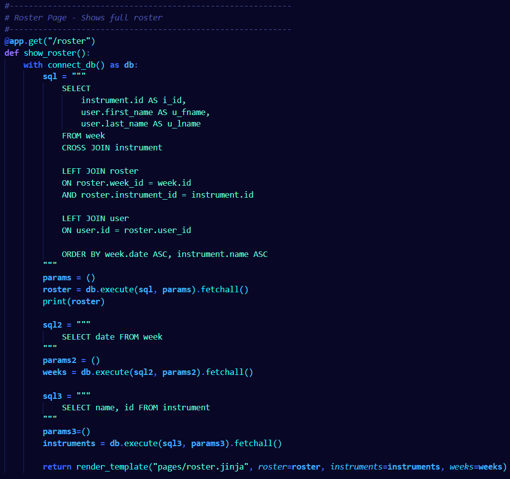

## Testing User Register (adding user to user table)

I am testing whether my app can add a user and all its associated data to the db. I tested this by getting my user register form, and inputting a test user. When this happened, everything worked as I intended it, and the correct tables were updated to show the new user.

Original user Table:

New User Table:

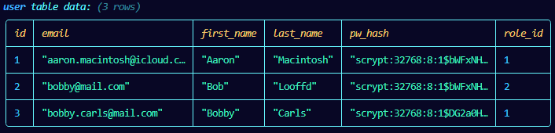

Instrument-User Table:

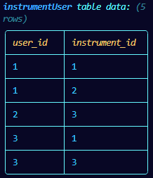

This resulted in the following card being displayed on the user list:

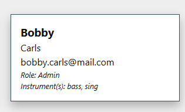

## Testing Resolve request

I am testing to see whether the admin users can resolve requests made by a user. This can happen when a user unexpectedly falls ill, or makes plans after they submit their unavailability ect.. I tested this by making a request in an account, then logging into the admin account, and resolving the request. The request was able to be submitted and 
resolved, however, I noticed that people where being showed as possible replacements even when they didn't play that instrument.   

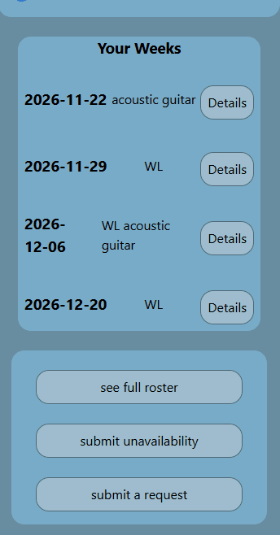

### Changes / Improvements

To improve the system, I added some code to add an "Instrument" to each person, and made it so that only people who played that instrument could be put down for that instrument

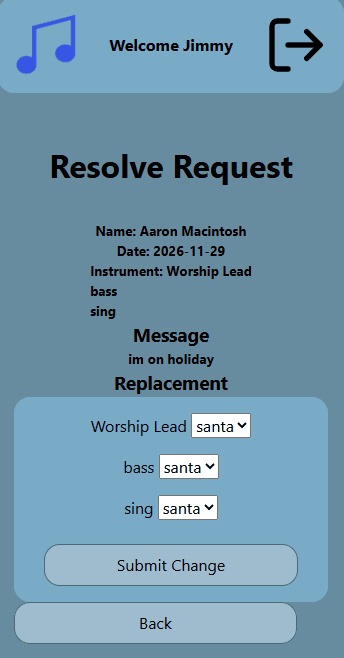

## Testing Week Initialization

I am testing to see if an admin user can initialise a week. This should make an empty week that, when the users submit thier unavialability, the admin can populate with musicians, to get added to the roster. I tested this by making a few test weeks to see if the correct date week was made, and if it would be made correctly. The testing showed a positive result on creating weeks, and the correct date (one week since the previous week) was implemented.

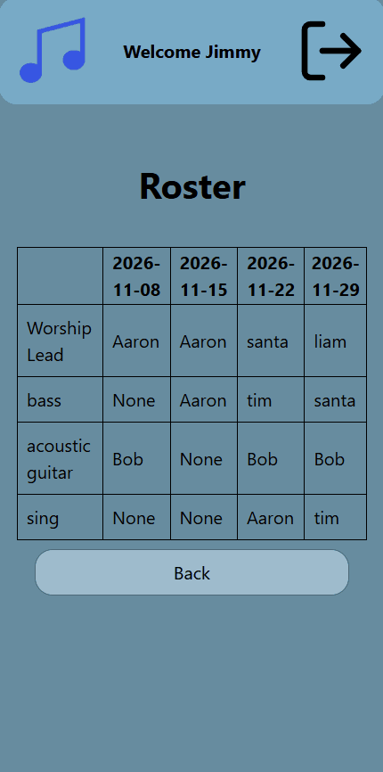

### Changes / Improvements

The testing showed the system working perfectly fine, so no changes were required.

## Testing FEATURE NAME HERE

Replace this text with notes about what you are testing, how you tested it, and the outcome of the testing

**PLACE SCREENSHOTS AND/OR ANIMATED GIFS OF THE TESTING HERE**

### Changes / Improvements

Replace this text with notes any improvements you made as a result of the testing.

**PLACE SCREENSHOTS AND/OR ANIMATED GIFS OF THE IMPROVED SYSTEM HERE**

## ETC...

## Sprint Review

Replace this text with a statement about how the sprint has moved the project forward - key success point, any things that didn't go so well, etc.

