# Sprint 3 - Developing a Minimum Viable Product (MVP)

## Sprint Goals

Continue to develop the web application to the point that it provides all key functionality of the system. Test and refine it so that it can serve as the basis for the final phase of development.

### Specific Goals

**Edit these goals as needed**

- Create the following web pages:
    - Form for ...
    - Etc.
- Develop SQL database queries to:
    - Add a new ...
    - Etc.

## Testing Roster display

I am testing the display of the roster. This is to see, with the test data I have put into the system, if it can display the full roster with every person and instrument in the correct week.

Using the following data, The roster returned should be:

Table Contents:

When I ran my algorithm (below), I kept getting an error, and when I fixed the error, it would return two empty lists, which is not what should happen.

### Changes / Improvements

When this would not work, I came up with a new approach that was much simpler, and worked perfectly. This new SQL query makes use of a Cross Join to join the tables, which was something new that I hadn't learnt before, and would then loop through the data on the Jinja template to get the correct display.

## Testing User Register

I am testing whether my app can add a user and all its associated data to the db. I tested this by getting my user register form, and inputting a test user. When this happened, everything worked as I intended it, and the correct tables were updated to show the new user.

Original user Table:

New User Table:

Instrument-User Table:

This resulted in the following card being displayed on the user list:

## Testing Resolve request

I am testing to see whether the admin users can resolve requests made by a user. This can happen when a user unexpectedly falls ill, or makes plans after they submit their unavailability ect.. I tested this by making a request in an account, then logging into the admin account, and resolving the request. The request was able to be submitted and 
resolved, however, I noticed that people where being showed as possible replacements even when they didn't play that instrument.   

### Changes / Improvements

To improve the system, I added some code to add an "Instrument" to each person, and made it so that only people who played that instrument could be put down for that instrument

## Testing Week Initialization

I am testing to see if an admin user can initialize a week. This should make an empty week that, when the users submit their unavailability, the admin can populate with musicians, to get added to the roster. I tested this by making a few test weeks to see if the correct date week was made, and if it would be made correctly. The testing showed a positive result on creating weeks, and the correct date (one week since the previous week) was implemented.

### Changes / Improvements

The testing showed the system working perfectly fine, so no changes were required.

## Testing Week Creation

I am testing to see whether or not the admin can add people to a week, and for it to be updated throughout the site. I tested this by making a few empty test weeks, then submitting unavailability for different people, then making the new week, based off the availability. When I tested this, it would show a list of all the users that played that instrument, even if they said that they were unavailable. This means that people could be put down for weeks they said they couldn't do.

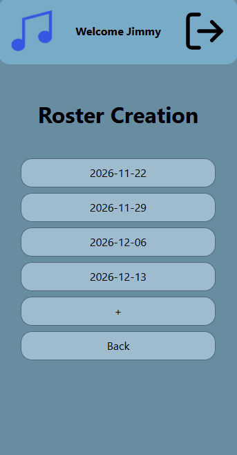

### Changes / Improvements

To fix this, I fixed a bug in the submitting unavailability form, where it would mark every week in the form as available, even if they said that they are unavailable for that day. When this got fixed, the form worked perfectly, as shown in the gif.

List of what the different test users put down for reference:

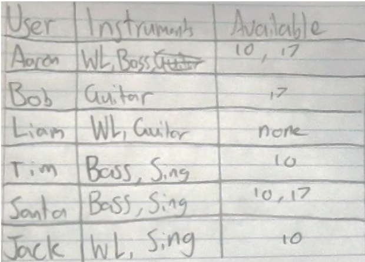

## Testing Submitting Unavailability

I am testing if the user can submit unavailability, and the if system handles it in the right way. To test this, I made a few test weeks, then went into a users account, and submitted unavailability. Then, I went to the admins account, and showed that the user did not show up as available to be on for the day that they submitted as unavailable. When I did this, the system worked as I expected it to, and the user only showed up on the days that they were available.

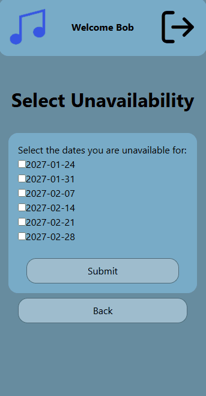

### Changes / Improvements

As my system worked well, it did not need any improvements.

## Testing Submitting a Request

I am testing to see if a user can successfully submit a request for one of their weeks. I tested this by submitting a trial request by a user. When I did this, the request was successfully handled by the program, and the correct things showed up for information when the admin went to resolve the request.

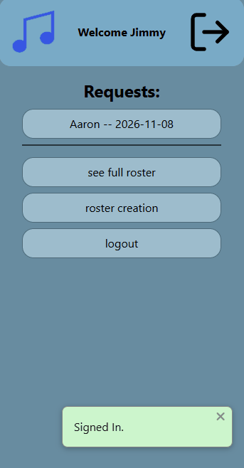

### Changes / Improvements

As the system worked as intended, the Web App did not need any improvements

## Testing Display of One Weeks Data

Replace this text with notes about what you are testing, how you tested it, and the outcome of the testing

**PLACE SCREENSHOTS AND/OR ANIMATED GIFS OF THE TESTING HERE**

### Changes / Improvements

Replace this text with notes any improvements you made as a result of the testing.

**PLACE SCREENSHOTS AND/OR ANIMATED GIFS OF THE IMPROVED SYSTEM HERE**

## Testing File Upload

I am testing to see if the system can upload a file to the system, to be displayed for users on that week to download. I tested this by uploading a file to a week where the user was a Week leader, as only week leaders can add files. When I added the file, it only allowed the correct file types to be selected, and when I uploaded it it got added successfully to the uploads folder, and users could successfully download the file.

Allowed Formats:

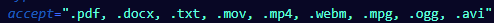

File Upload:

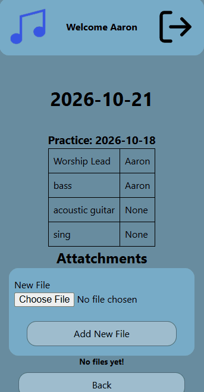

File Download:

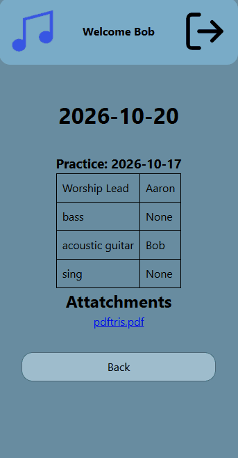

### Changes / Improvements

The system worked well, being able to handle uploading, downloading and only allowing certain types of files, so it did not need changing

## Testing Week Delete

I am testing the automatic delete of weeks. When the home page is opened, the program automatically checks for past weeks, and deletes them if any are present. I tested this by making a week in the past, with links to files, and all tables.

Weeks being deleted:

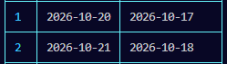

Data to be deleted:

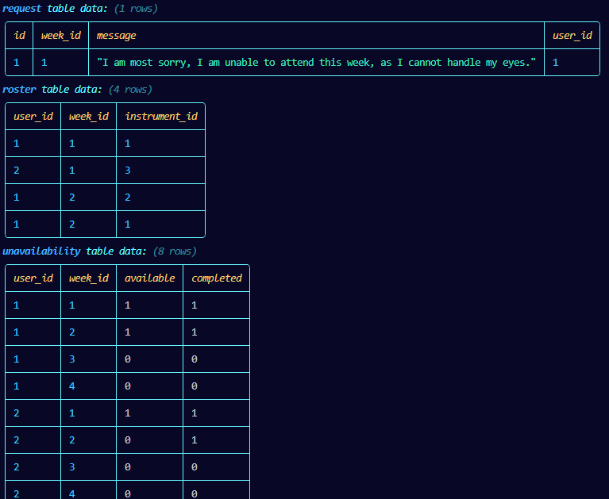

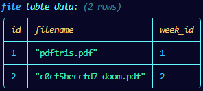

Delete actions:

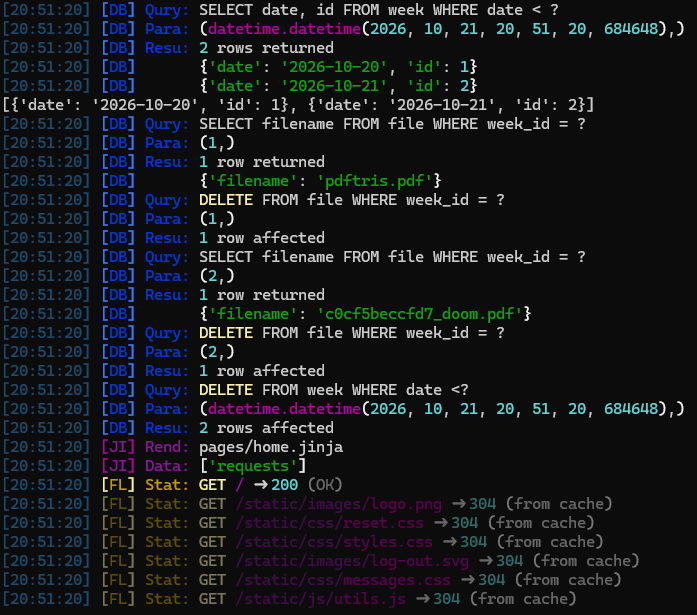

New Data:

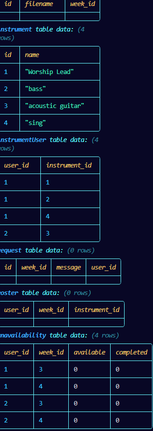

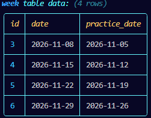

### Changes / Improvements

This worked well the first time, however, if a week is put in the db with seed data, if the file is already deleted, It would throw an error. To improve this, I added a check to make sure the app would only delete a file if one with its name exists in the uploads folder.

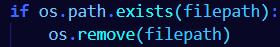

## Sprint Review

Replace this text with a statement about how the sprint has moved the project forward - key success point, any things that didn't go so well, etc.

