# Sprint 4 - Developing a Refined and Complete System

## Sprint Goals

Develop the system until it is fully featured, with a refined UI and it satisfies the requirements. The system will be fully tested at this point.

### Specific Goals

- Refine the design and UI of the website
- Refine the user experience (UX) of the system
- Validate HTML and CSS

## Testing Top Banner

When I was showing my user my end user my site, they thought that the banner at the top could be improved. They wanted the logout and Logo to be smaller, and they thought that it should be sticky, and stick to the top of the screen when you scroll.

### Changes / Improvements

Due to this feedback, I made the suggested changes, and decreased the size of the icons, and made the banner sticky.

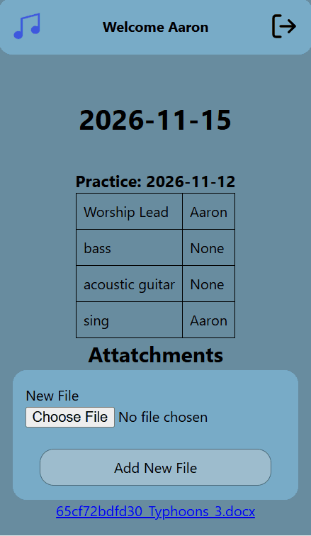

## Testing Form Styling

When I showed the Site to the end User, they said that the forms needed restyling, as the current style was not very good to look at, and could be improved to look more professional. While trying to fix this, I ran into some problems with checkboxes and radio button inputs, as shown below.

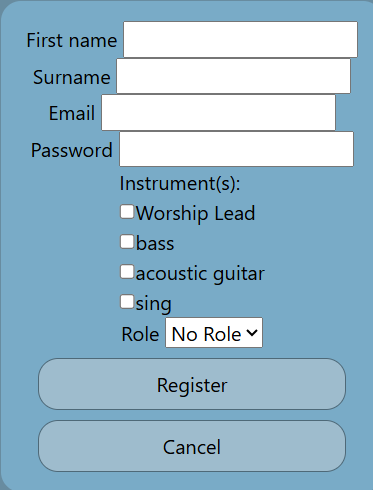

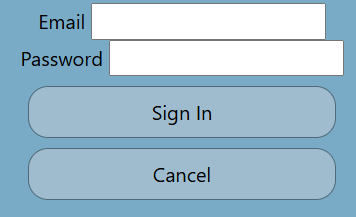

Checkbox/radio button issues:

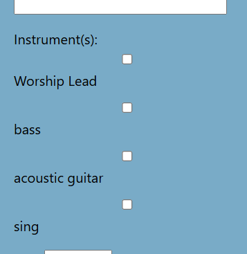

### Changes / Improvements

To fix this styling problem, I made a big change to the styling in the form, and I managed to make the forms look more professional, and the end user liked them much more, and the checkboxes worked the way they were supposed to.

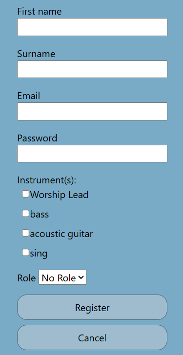

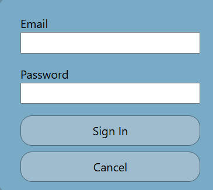

## Testing Color scheme

When I initially discussed color schemes with the end User, they chose a blue color scheme for the website. To Implement this, I copied the colors into my CSS stylesheet, and implemented the colours.

No Colours:

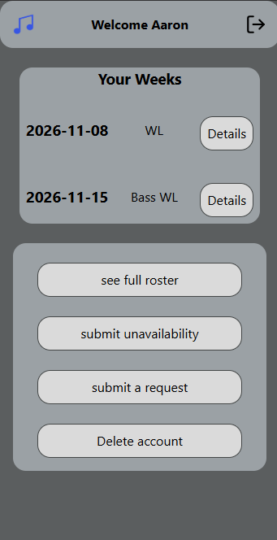

Colour:

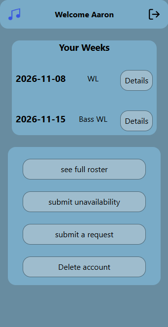

### Changes / Improvements

When the User saw this, they were happy, but thought a white background could be better, and a dark grey one for dark mode. I implemented this, and we both agreed that it looked better.

Dark:

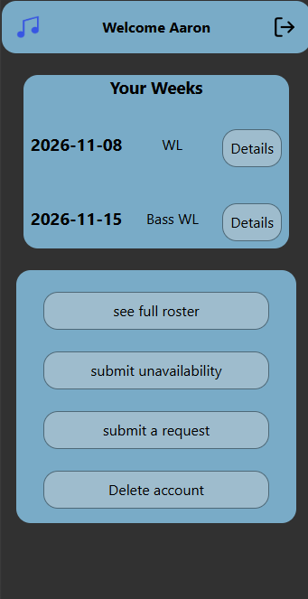

Light:

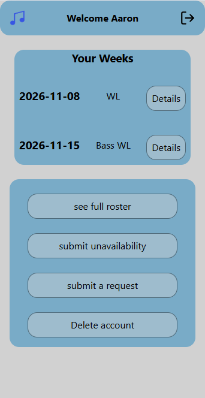

## Testing Font

When I initially showed my user the design, they decided that Epunda Sans was the best font for the site. So, I added Epunda Sans font to my site.

Default Font:

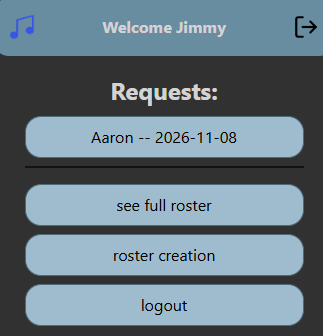

Epunda Sans:

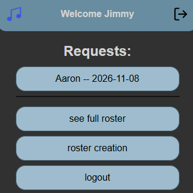

### Changes / Improvements

When I showed this to the end User, they said that it looked good, and I agreed, so the System did not need improving

## Testing Flash Display

Initially, the flash messages would only go away if you manually clicked the 🗙 button, which my end user thought was no good. So, to fix this, I added some code to make the flash messages disappear after ten seconds.

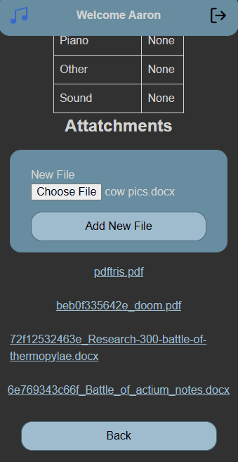

### Changes / Improvements

When I showed this to the user, they said that was too long, and suggested 5 seconds. I thought that this was too short and wanted 7, and so we settled on 6 seconds, and now the flash disappears after 6 seconds.

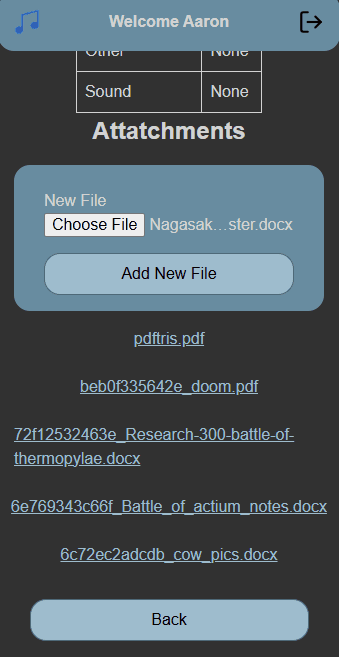

## Testing Page Layout

Replace with What you tested, How you tested it, the out come of the testing

Images of testing

### Changes / Improvements

Replace with changes and improvements made due to testing

Images of improved system

## Testing TEST NAME HERE 

Replace with What you tested, How you tested it, the out come of the testing

Images of testing

### Changes / Improvements

Replace with changes and improvements made due to testing

Images of improved system

## ETC...

## Sprint Review

Replace this text with a statement about how the sprint has moved the project forward - key success point, any things that didn't go so well, etc.

