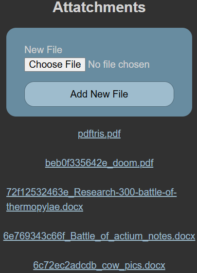
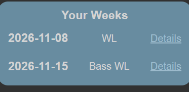
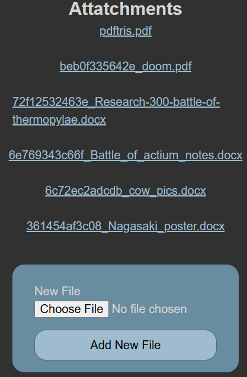
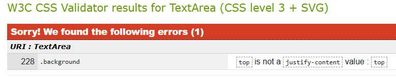
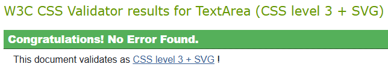
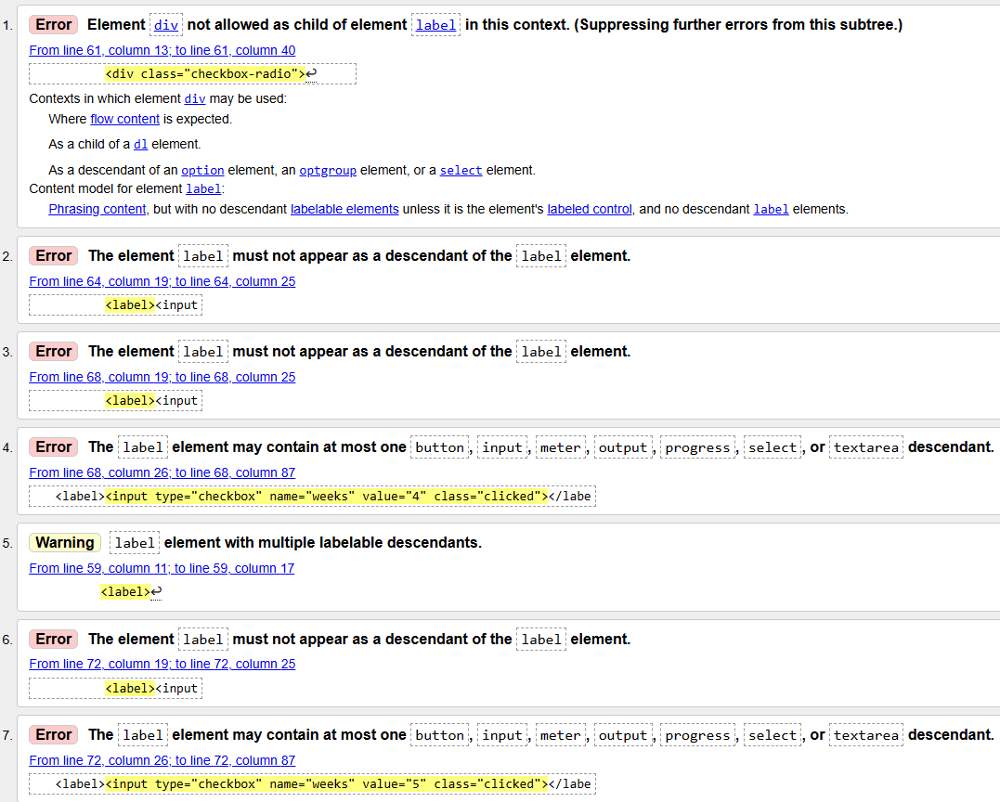
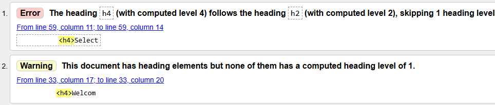
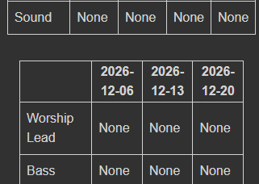
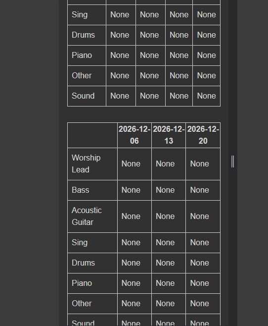

# Sprint 4 - Developing a Refined and Complete System

## Sprint Goals

Develop the system until it is fully featured, with a refined UI and it satisfies the requirements. The system will be fully tested at this point.

### Specific Goals

- Refine the design and UI of the website
- Refine the user experience (UX) of the system
- Validate HTML and CSS

## Testing Top Banner

When I was showing my user my end user my site, they thought that the banner at the top could be improved. They wanted the logout and Logo to be smaller, and they thought that it should be sticky, and stick to the top of the screen when you scroll.

### Changes / Improvements

Due to this feedback, I made the suggested changes, and decreased the size of the icons, and made the banner sticky.

## Testing Form Styling

When I showed the Site to the end User, they said that the forms needed restyling, as the current style was not very good to look at, and could be improved to look more professional. While trying to fix this, I ran into some problems with checkboxes and radio button inputs, as shown below.

Checkbox/radio button issues:

### Changes / Improvements

To fix this styling problem, I made a big change to the styling in the form, and I managed to make the forms look more professional, and the end user liked them much more, and the checkboxes worked the way they were supposed to.

## Testing Color scheme

When I initially discussed color schemes with the end User, they chose a blue color scheme for the website. To Implement this, I copied the colors into my CSS stylesheet, and implemented the colours.

No Colours:

Colour:

### Changes / Improvements

When the User saw this, they were happy, but thought a white background could be better, and a dark grey one for dark mode. I implemented this, and we both agreed that it looked better.

Dark:

Light:

## Testing Font

When I initially showed my user the design, they decided that Epunda Sans was the best font for the site. So, I added Epunda Sans font to my site.

Default Font:

Epunda Sans:

### Changes / Improvements

When I showed this to the end User, they said that it looked good, and I agreed, so the System did not need improving

## Testing Flash Display

Initially, the flash messages would only go away if you manually clicked the 🗙 button, which my end user thought was no good. So, to fix this, I added some code to make the flash messages disappear after ten seconds.

### Changes / Improvements

When I showed this to the user, they said that was too long, and suggested 5 seconds. I thought that this was too short and wanted 7, and so we settled on 6 seconds, and now the flash disappears after 6 seconds.

## Testing Page Layout

When I showed the website to the end user, they said that some of the pages could have better layouts. For example, on the individual week page, they thought that the files that have already been uploaded should be above the form to upload more files, and on the homepage, they thought that the buttons for taking you to an individual week page took up too much space, and should be links instead. To fix these problems, and more, I went through the pages to make sure that they all had a good and consistent layout, with things being all center aligned to look smart and professional, consistent coloring for similar elements in the same region of the site, and an easy to follow layout.

Old Layouts:

New Layouts:

### Changes / Improvements

When I showed these changes to the end user, they were happy, so I did not need to update the system.

## Testing CSS Validation

To make sure my CSS is valid, and is up to web standards, and wont silently crash my web app, I put it through a CSS validator. When I did, it came back with one error message:

### Changes / Improvements

To fix this, I went to the error discovered by the validator, and fixed the error so it would be valid CSS. When I ran it through the Validator, no errors were found, meaning my websites styles are fully valid, and wont accidentally crash my site

## Testing HTML Validation

To make sure my HTML is valid, and is up to web standards, and wont silently crash my web app, I put some pages through an HTML validator. When I did, some pages were fine, with only minor errors, like " Section lacks heading" due to me not having an h1 tag, or saying that I skipped h3, and went straight to h4. However, some came back with many errors due to things like my use of divs in labels, which is not allowed.

### Changes / Improvements

To fix this, I went to the error discovered by the validator, and changed the way my form was layed out to get rid of the divs that were in the labels, and put the text inside the label instead of outside the label to make it good for the validator. When I did this, the validator came back with the same, minor errors/warnings that don't matter.

## Testing Responsive tables

When I showed the system to my end user, they thought the tables should always be 100% of the width of the container, so they don't look all out of place and ugly. This is because the table only generates the values in set widths, and won't be responsive to the changing of width of the screen.

### Changes / Improvements

To fix this, I added the width: 100%; css tag to the stylesheet of the tables, and now they scale with the page.

## Sprint Review

This sprint was a very good one. It helped move the project forward, as it helped me to finish the project. In this sprint, I went from a functioning site, to one that looks good, and implements the design choices that my end user and I had decided on while the project was just in the prototyping phase. It also allowed me to make design choices for the final product that we hadn't considered while it was still in the prototype, or development phase. This sprint saw the conclusion of the project in terms of functionality, UX, and UI choices, and is now ready for use. What went well with this sprint was how it took relatively little time to finalize compared to the other sprints, which took longer than I had expected. This was a success, as it meant that although I was behind during the other sprints, this sprint helped me to catch up on time, to be able to finish the project on time. Something that didn't go so well was some design choices that I thought the end user was happy with, they decided that they should be changed. This was mostly the colour of the background. This set me back, as I had to now worry about restyling most things to work with the new background colours that the end user chose. Overall, however, the sprint was a massive success, as it helped finish the project, and by the end of it, I had a web app that both me and my end user was happy with.
